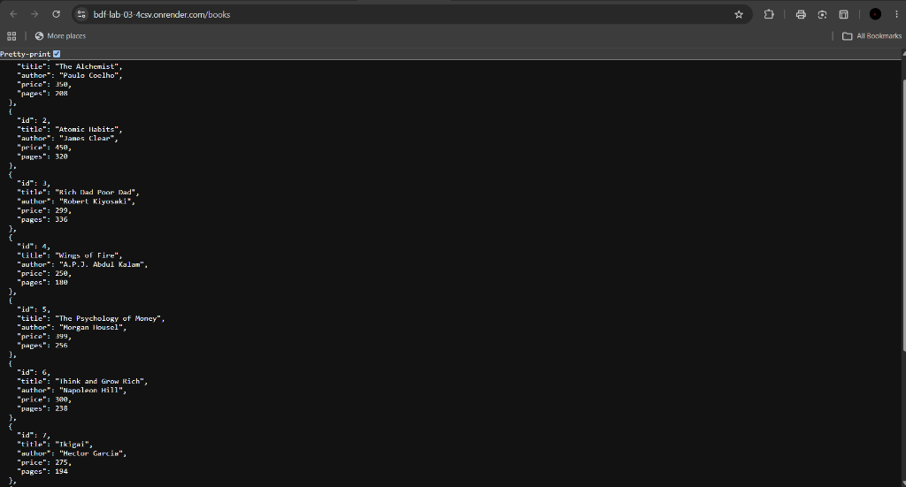
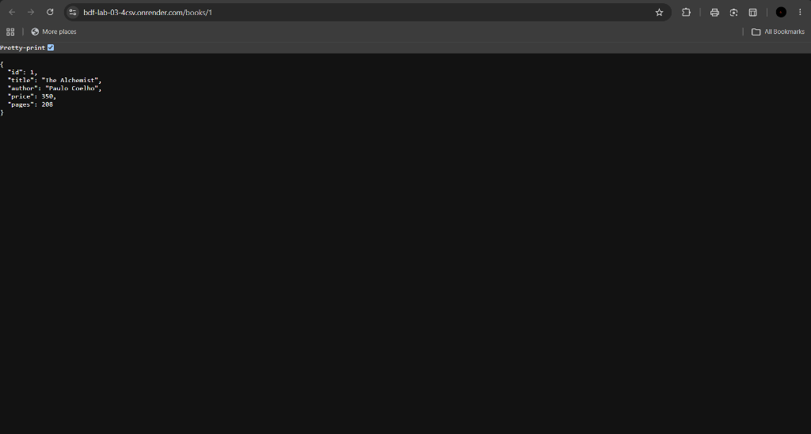
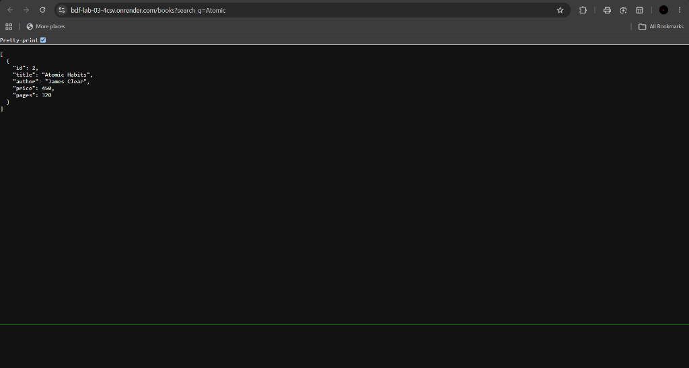
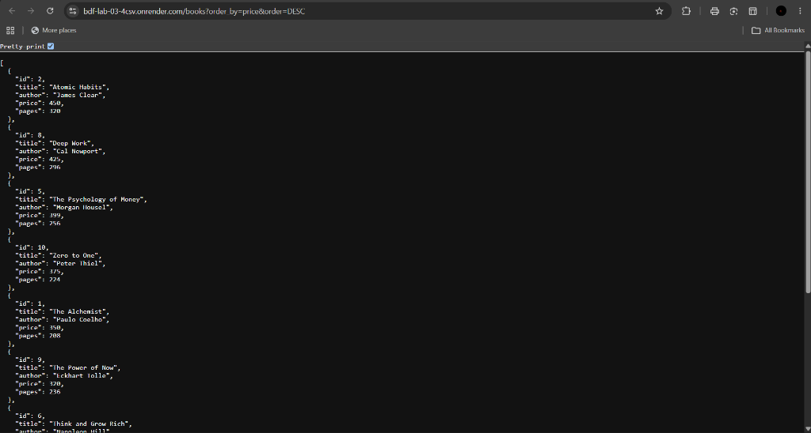

# Lab 3: REST API, Query Parameters, Validation and Debugging

**Name:** SIVA MANIDHAR REDDY
**Registration Number:** 252U1R8076  
**Class:** B.Tech CSE (Quantum Engineering) – 2B  
**Section:** S-13 204  
**Server:** `https://backend-lab-3-7ftb.onrender.com`

## Objective

Convert the CRUD routes developed in Lab 02 into a clean REST API. Implement query parameters for searching, sorting, pagination and price filtering. Validate incoming POST requests, return appropriate HTTP status codes, maintain consistent JSON error responses and practise debugging common errors.

## Technologies Used

- Node.js
- Express.js
- SQLite
- `sqlite` and `sqlite3`
- Nodemon
- Postman

## Project Setup and Execution

1. Open a terminal inside the `lab-03` folder.
2. Install the project dependencies:

   ```bash
   npm install
   ```

3. Start the development server:

   ```bash
   npm run dev
   ```

4. The server runs at:

   ```text
   http://localhost:3000
   ```

## Database

The SQLite database is located at `database/books.db`.

The `book` table contains the following columns:

| Column | Data Type | Description |
|---|---|---|
| `id` | INTEGER | Primary key |
| `title` | TEXT | Book title |
| `author` | TEXT | Book author |
| `price` | INTEGER | Book price |
| `pages` | INTEGER | Number of pages |

The database contains sample book records used for API development and testing.

## API Endpoints

| Method | Endpoint | Description |
|---|---|---|
| GET | `/books` | Retrieve books with query parameters |
| GET | `/books/:bookId` | Retrieve a book by its ID |
| POST | `/books` | Add a new book |
| PUT | `/books/:bookId` | Update a book by its ID |
| DELETE | `/books/:bookId` | Delete a book by its ID |

## Query Parameters

The `GET /books` endpoint supports the following query parameters:

| Parameter | Description |
|---|---|
| `search_q` | Search books by partial title |
| `order_by` | Sort using a valid column |
| `order` | Sorting order: ASC or DESC |
| `limit` | Maximum number of records to retrieve |
| `offset` | Number of records to skip |
| `min_price` | Minimum book price |
| `max_price` | Maximum book price |

Example:

```text
http://localhost:3000/books?search_q=Atomic
http://localhost:3000/books?order_by=price&order=DESC
http://localhost:3000/books?limit=3&offset=0
http://localhost:3000/books?min_price=250&max_price=400
```

## Validation and HTTP Status Codes

The POST endpoint validates the incoming JSON body.

- Missing title returns `400 Bad Request`.
- Missing author returns `400 Bad Request`.
- Invalid or non-numeric price returns `400 Bad Request`.
- Successful book creation returns `201 Created`.

The API also uses the following status codes:

| Status Code | Description |
|---|---|
| `200` | Successful GET, PUT or DELETE request |
| `201` | Book successfully created |
| `400` | Invalid request data |
| `404` | Requested book does not exist |
| `500` | Internal server error |

Error responses use a consistent JSON message format.

## Screenshots

### 1. GET API – Retrieve All Books


### 2. GET API – Search Books


### 3. GET API – Sorting Books


### 4. GET API – Pagination (First Page)


### 5. GET API – Pagination (Second Page)


### 6. GET API – Minimum Price Filter


### 7. GET API – Maximum Price Filter


### 8. GET API – Price Range Filter


### 9. GET API – Retrieve Book by ID


### 10. POST API – Missing Title Validation


### 11. POST API – Missing Author Validation


### 12. POST API – Invalid Price Validation


### 13. POST API – Successful Book Creation


### 14. GET API – Verify Created Book


### 15. GET API – Invalid Book ID


### 16. PUT API – Update Book


### 17. GET API – Verify Updated Book


### 18. DELETE API – Delete Book


### 19. GET API – Verify Book Deletion


## Debugging Common Errors

The following debugging exercises were performed as part of the lab:

1. **Port conflict (`EADDRINUSE`):** Identified an existing process using port 3000 and resolved the port conflict.
2. **Wrong import path:** Practised identifying and correcting an invalid module or file import path.
3. **Table-name typo:** Identified the SQLite error caused by using an incorrect table name and restored the correct table name.
4. **Missing `await`:** Observed the incorrect response caused by not awaiting an asynchronous database query and restored `await`.

### Debugging Screenshots


## Problems Faced and Solutions

- **Query parameter handling:** Implemented query parameters to support searching, sorting, pagination and price filtering.
- **Request validation:** Added validation to reject missing required fields and invalid prices.
- **HTTP status codes:** Used appropriate status codes for successful requests, invalid input and missing records.
- **Database errors:** Practised identifying and correcting incorrect table names and asynchronous query handling.
- **Port conflict:** Identified the process occupying the required port and resolved the conflict.
- **API testing:** Used Postman to test successful and unsuccessful API requests.

## Notes

- SQL queries use `?` placeholders for user-provided values.
- Sorting columns are restricted to valid database columns.
- The API uses consistent JSON messages for errors.
- Asynchronous database operations use `await`.
- `node_modules` and `.env` are excluded from GitHub using `.gitignore`.
- The SQLite database and API testing screenshots are maintained in the project folder.

## Deployment

The REST API is deployed on Render and accessible through the following URL:

**Live Application:** [https://bdf-lab-03-4csv.onrender.com](https://bdf-lab-03-4csv.onrender.com)

### Live API Endpoints

- GET all books: [https://bdf-lab-03-4csv.onrender.com/books](https://bdf-lab-03-4csv.onrender.com/books)
- GET book by ID: [https://bdf-lab-03-4csv.onrender.com/books/1](https://bdf-lab-03-4csv.onrender.com/books/1)

The application is hosted using Render's free web service plan.

### Live API Screenshots and Verification

The following screenshots demonstrate the verified live behavior of the deployed application on Render:

#### 1. Live Root URL Verification


- **URL:** `https://bdf-lab-03-4csv.onrender.com/`
- **Explanation:** Accessing the base root URL returns Express's default `Cannot GET /` response (HTTP 404). This confirms that the web service is deployed, actively running on Render, and listening for incoming HTTP requests.

#### 2. Live GET All Books



- **URL:** `https://bdf-lab-03-4csv.onrender.com/books`
- **Explanation:** Tests the live `/books` endpoint. The server connects to the deployed SQLite database and returns the full list of books in JSON format with an HTTP 200 OK status.

#### 3. Live GET Book by ID



- **URL:** `https://bdf-lab-03-4csv.onrender.com/books/1`
- **Explanation:** Tests path parameter routing with `:bookId` set to `1`. The database query retrieves and returns the matching book record (*"The Alchemist"*) with an HTTP 200 OK status.

#### 4. Live Search Filtering Query



- **URL:** `https://bdf-lab-03-4csv.onrender.com/books?search_q=Atomic`
- **Explanation:** Verifies the `search_q` query parameter. The server filters books using a SQL `LIKE '%Atomic%'` clause and returns the matching record (*"Atomic Habits"*).

#### 5. Live Sorting Query (Price Descending)



- **URL:** `https://bdf-lab-03-4csv.onrender.com/books?order_by=price&order=DESC`
- **Explanation:** Verifies the `order_by` and `order` query parameters. The query sorts records dynamically by price in descending order (highest price first: 450, 425, 399, etc.) and returns the sorted array with HTTP 200 OK.

## Conclusion

Lab 03 provided practical experience in developing a REST API with Express.js and SQLite. Query parameters, input validation, HTTP status codes and debugging techniques were implemented and tested. Postman was used to verify the API's successful operations and failure cases.
